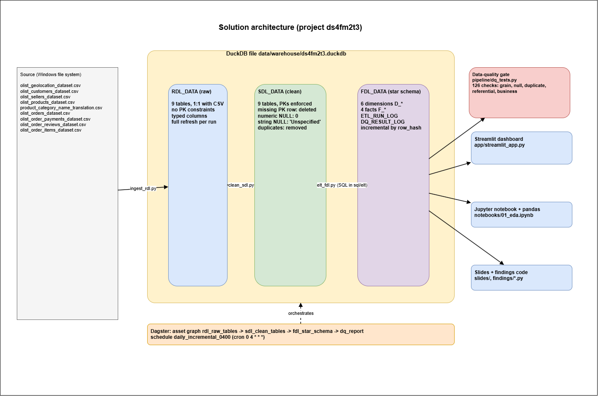
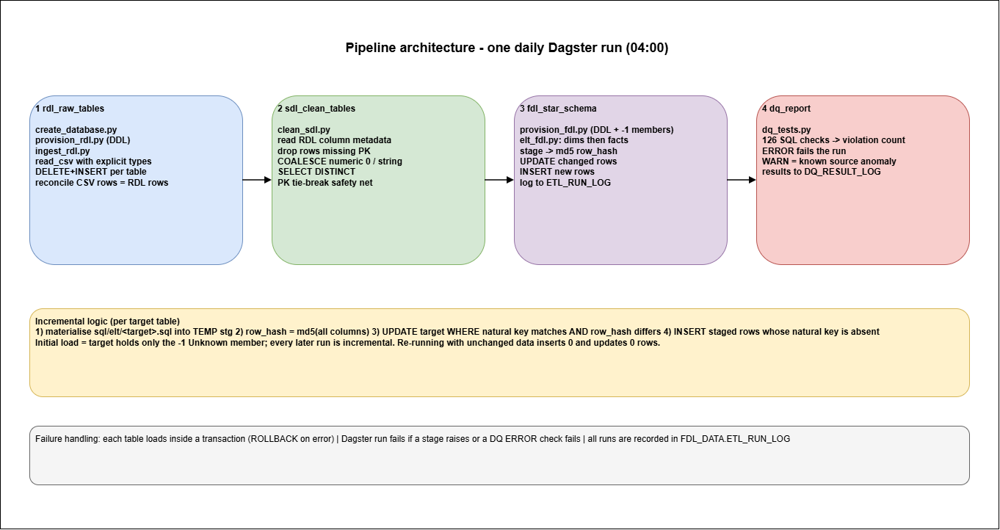
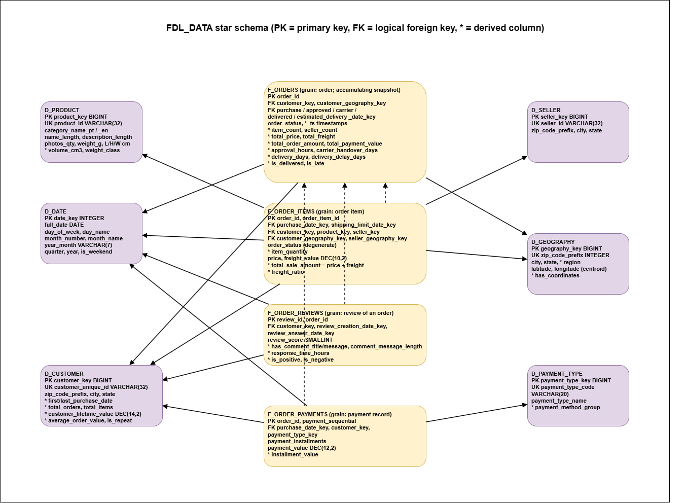

# Design document

## 1. Architecture
Source CSV (Windows folder) -> **RDL_DATA** (raw) -> **SDL_DATA** (clean) -> **FDL_DATA** (star schema) -> consumers. One DuckDB file (`data/warehouse/ds4fm2t3.duckdb`) holds all three schemas. 

The overview architecture is:

Dagster runs the four stages as an asset graph every day at 04:00. 
The pipeline view of architecture is:

Diagrams: `diagrams/architecture.drawio`, `diagrams/pipeline_architecture.drawio`, `diagrams/pipeline_system.excalidraw`.

| Stage | Module | Behaviour |
|---|---|---|
| Create DB | `pipeline/create_database.py` | creates empty `.duckdb` + 3 schemas (idempotent, `--reset`) |
| Raw DDL | `sql/rdl/create_rdl_tables.sql`, `provision_rdl.py` | 9 typed tables, no PK constraints |
| Ingest | `ingest_rdl.py` | `read_csv` with explicit column types, `d/m/yyyy H:MM` timestamp format, DELETE+INSERT per table in a transaction, then reconcile CSV rows = table rows |
| Clean | `clean_sdl.py` | contract rules, SDL tables rebuilt each run |
| Star DDL | `sql/fdl/*.sql`, `provision_fdl.py` | 6 dimensions, 4 facts, 2 control tables, `-1` Unknown members |
| ELT | `elt_fdl.py`, `sql/elt/*.sql` | generic initial + incremental loader |
| DQ | `dq_tests.py` | 126 SQL checks, results persisted |

## 2. Unique keys identified from profiling
| Table | Rows | Unique key | Evidence |
|---|---|---|---|
| GEOLOCATION | 1,000,163 | all 5 columns (after dedup: 738,332) | no natural key; zip prefix repeats; 261,831 full duplicates; city spelling varies ("sao paulo"/"são paulo") so city is part of the key |
| CUSTOMERS | 99,441 | customer_id | unique; `customer_unique_id` has only 96,096 values (customer_id is per order) |
| SELLERS | 3,095 | seller_id | unique |
| PRODUCTS | 32,951 | product_id | unique |
| PRODUCT_CATEGORY_TRANSLATION | 71 | product_category_name | unique |
| ORDERS | 99,441 | order_id | unique |
| ORDER_PAYMENTS | 103,886 | (order_id, payment_sequential) | order_id repeats |
| ORDER_REVIEWS | 99,224 | (review_id, order_id) | review_id alone repeats 814 times |
| ORDER_ITEMS | 112,650 | (order_id, order_item_id) | order_id repeats |

Referential facts found: all order/payment/review/item foreign keys resolve; 278 customer rows and 7 seller rows use zip prefixes absent from GEOLOCATION; two product categories (`pc_gamer`, `portateis_cozinha_e_preparadores_de_alimentos`) have no translation; 775 orders have no items.

## 3. Cleaning (contract rules and interpretations)
Order applied: (1) delete rows with a missing PK part; (2) numeric NULL -> 0; (3) string NULL or blank -> `'Unspecified'`; (4) duplicates removed via `SELECT DISTINCT`.

Actual effect on this data: GEOLOCATION 261,831 duplicate rows removed; PRODUCTS 610 rows with category -> `Unspecified` and name/description/photo counts -> 0, plus 2 rows with weight/dimensions -> 0; ORDER_REVIEWS 87,658 titles and 58,256 messages -> `Unspecified`; no rows missing a PK.

Decisions to confirm (the contract is silent):
* **TIMESTAMP columns keep NULL.** They are neither numeric nor string, and 0 / `'Unspecified'` is not a valid timestamp. A NULL delivery date legitimately means "not delivered yet" (2,965 orders).
* **Blank strings count as missing** (2 extra review titles, 9 extra messages).
* **PK tie-break safety net** (recommendation): if distinct rows still shared a PK it would keep one and log it. It triggered 0 times.
* **Products with 0 weight/size** come from the "numeric -> 0" rule; the dimension treats 0 as unknown (`weight_class = 'Unknown'`, `volume_cm3 = NULL`) so averages are not distorted.

## 4. Star schema design
The Star schema diagram:

### Subject areas and grain
| Fact | Grain | Business process / questions |
|---|---|---|
| F_ORDER_ITEMS | one order item | sales: revenue, units, freight by product, seller, customer, geography, time |
| F_ORDERS | one order (accumulating snapshot) | fulfilment: approval, hand-over and delivery times, lateness, order value |
| F_ORDER_PAYMENTS | one payment record | payment mix, instalments |
| F_ORDER_REVIEWS | one review of an order | satisfaction, response time |

Dimensions: D_DATE (calendar, role-played by all date keys), D_CUSTOMER (real customer), D_PRODUCT, D_SELLER, D_GEOGRAPHY (zip prefix; role-played as customer and seller geography), D_PAYMENT_TYPE. Full column list with types and sizes: `06_data_dictionary.md`. Naming follows the contract: `D_` and `F_` prefixes.

### Derived columns
`total_sale_amount`, `freight_ratio`, `item_quantity` (F_ORDER_ITEMS); `total_price`, `total_freight`, `total_order_amount`, `total_payment_value`, `approval_hours`, `carrier_handover_days`, `delivery_days`, `estimated_delivery_days`, `delivery_delay_days`, `is_delivered`, `is_late` (F_ORDERS); `installment_value`; review flags and `response_time_hours`; D_CUSTOMER `first/last_purchase_date`, `total_orders`, `total_items`, **`customer_lifetime_value`**, `average_order_value`, `is_repeat_customer`; D_PRODUCT `volume_cm3`, `weight_class`; D_GEOGRAPHY `region`, `has_coordinates`.

Definitions: *valid order* = status not `canceled`/`unavailable`. CLV = sum of (price + freight) over a customer's valid orders (historical value, not a prediction). `is_late` compares delivery **date** with estimated **date** (so a same-day delivery is on time); it is NULL when undelivered.

### Design justification
* **Separate facts per grain** avoid double counting: an order total repeated on each item row would inflate sums, so order-level measures live in F_ORDERS and item-level in F_ORDER_ITEMS.
* **Customer keyed on `customer_unique_id`.** Olist assigns a new `customer_id` per order; keying on it would make every customer look like a one-time buyer. Facts map `customer_id` -> unique customer at load time.
* **Conformed dimensions** let one query combine items, payments and reviews (drill-across) by the same date, customer and geography.
* **Surrogate integer keys + `-1` Unknown members**: narrow joins (DuckDB is columnar, so narrow keys compress and scan fast), and facts never hold NULL keys, so inner joins never silently drop rows.
* **Role-playing date and geography dimensions** avoid copying calendar and location attributes into every table.
* **Denormalised dimensions** (e.g. category names, region in D_GEOGRAPHY) mean most questions need one join per dimension, which is what star schemas are chosen for.
* **Physical FKs are not declared.** DuckDB restricts UPDATE/DELETE on tables involved in FK constraints, which would block incremental updates. Integrity is enforced by 27 referential tests instead (standard warehouse practice).
* **Geography:** median of points inside Brazil's bounding box per zip prefix (source has stray points at e.g. lat 45 / lng 121); 167 zip prefixes have no coordinates and are flagged `has_coordinates = FALSE` rather than given 0,0.

## 5. Incremental load design
Per target: stage the SQL result, compute `row_hash = md5(all columns)`, `UPDATE` rows whose natural key exists with a different hash, `INSERT` rows whose key is absent, all in one transaction, logged to `ETL_RUN_LOG`. First run is `INITIAL` (target holds only the `-1` member); later runs are `INCREMENTAL`.

Why hash-compare rather than a high-watermark: the source has no reliable "modified at" column, and orders change after creation (status, delivery date). A watermark on purchase date would miss those changes; hashing catches them and also keeps D_CUSTOMER aggregates correct when new orders arrive. Cost: each run reads all of SDL (about 3 seconds here). At much larger scale, add a source change timestamp and filter staging by it.

Limits: source deletions are not propagated (facts are retained); dimensions are SCD type 1 (history is overwritten) - no history tracking was required.

Evidence (tests/test_pipeline.py): re-run inserts/updates 0 rows; loading 79,441 orders then topping up gives exactly the 20,000 new orders and facts identical to a one-shot load; a changed order status is applied as 1 update.

## 6. Data quality testing
126 checks in 5 categories (all in `pipeline/dq_tests.py`): GRAIN 15, NULL 47, DUPLICATE 13, REFERENTIAL 27, BUSINESS 24. Severity ERROR fails the pipeline; WARN reports a known source anomaly. Latest run: **117 pass, 0 fail, 9 warn**.

| Warning | Rows | Meaning |
|---|---|---|
| carrier hand-over dated before approval | 1,358 | source timestamps inconsistent |
| carrier hand-over dated before purchase | 161 | same |
| delivery dated before carrier hand-over | 23 | same |
| payments differ from items + freight by > 1.00 | 250 | vouchers / rounding / source |
| delivered status, no delivery date | 8 | source |
| non-delivered status, has delivery date | 6 | source |
| non-cancelled orders with zero items | 8 | source |
| order with no payment | 1 | source |
| 0-instalment payment rows | 2 | source |

During development one test initially failed because it combined hard rules with these anomalies; it was split rather than loosened, so the hard rule (nothing is approved or delivered before purchase) remains an ERROR.

## 7. Tool choices
| Choice | Why | Alternatives considered |
|---|---|---|
| DuckDB | mandated; embedded columnar OLAP engine, zero server, fast CSV reader, full SQL | Postgres (needs a server), SQLite (row store, weak analytics) |
| SQL files for transformations | set-based, readable by analysts, version-controlled, run inside the engine | pandas transforms (slower, hold data in memory, harder to audit) |
| Python orchestration glue | mandated; thin, testable functions | shell scripts |
| Dagster | mandated; asset graph shows lineage, built-in schedule + run history + metadata | Airflow (heavier, task-centric), cron (no visibility) |
| Streamlit + Plotly | mandated; dashboard in one Python file | BI tool (licence, outside Python stack) |
| pytest | end-to-end tests on real data | manual checks |

## 8. Scalability notes
DuckDB handles hundreds of millions of rows on one machine. The hash approach is O(rows in SDL) per run; the staging query pattern, surrogate keys and per-table jobs are unchanged if the engine later moves to MotherDuck/Snowflake/BigQuery (SQL is largely portable; `strip_accents`, `median` and `epoch` would need equivalents).
