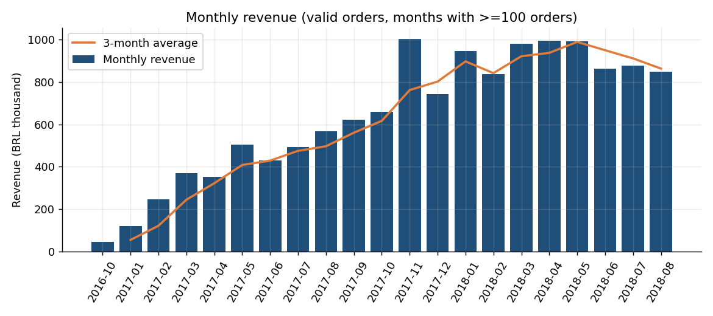
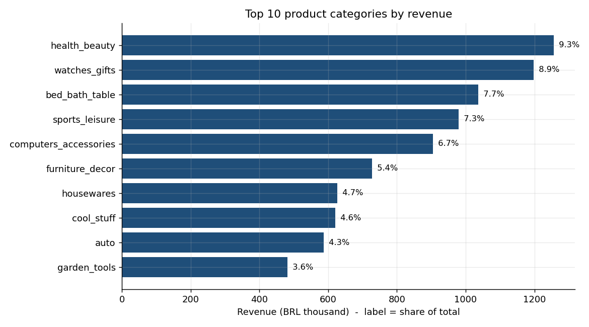
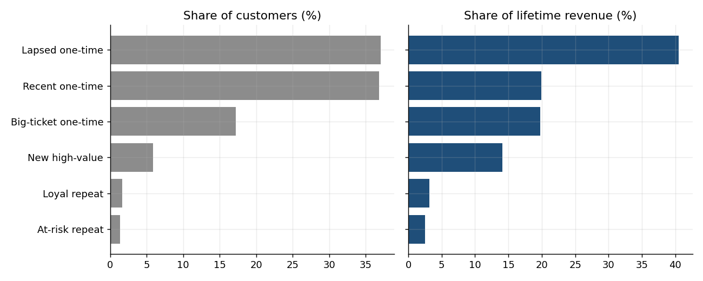
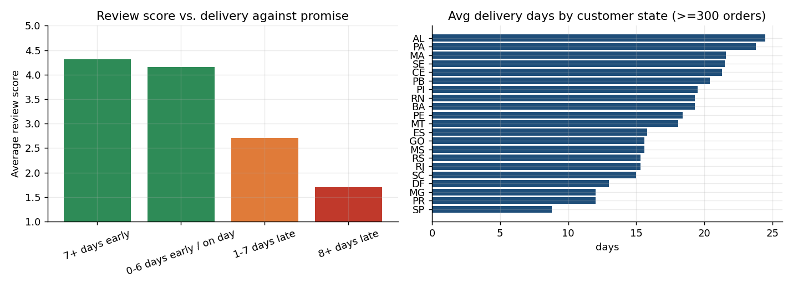
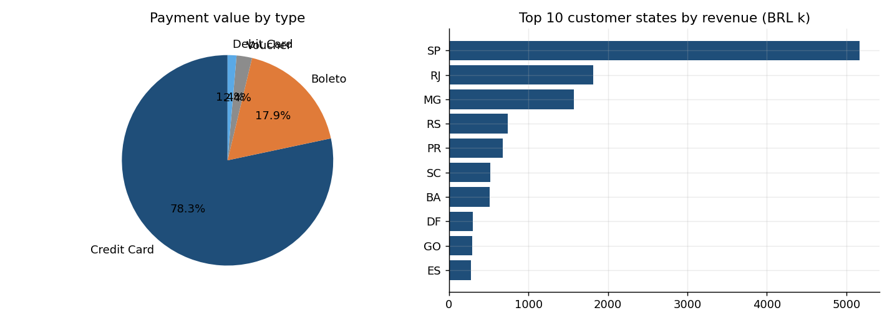

# Technical report and findings

## 1. Approach
Nine Olist CSV files were profiled, loaded unchanged into a raw schema, cleaned under explicit contract rules, remodelled as a four-fact star schema, and loaded by an idempotent incremental ELT. A 126-check quality suite gates every scheduled run. Design reasoning: `02_design_document.md`. All figures below come from `findings/*.py`; headline numbers are stored in `reports/key_numbers.json`.

Scope: 99,441 orders (Sep 2016 - Oct 2018), 112,650 order items, 96,096 unique customers, 3,095 sellers, 32,951 products. "Valid" orders exclude canceled and unavailable. Revenue = sum of item price (BRL 13.49M; GMV including freight BRL 15.74M across 98,199 valid orders).

## 2. Pipeline results
| Stage | Result |
|---|---|
| Ingestion | 9 files, 1,550,922 rows; CSV rows = table rows |
| Cleaning | 261,831 duplicate geolocation rows removed; 610 products with missing category/attributes; no missing PKs |
| Warehouse | 6 dimensions, 4 facts; 96,097 customers (incl. Unknown), 99,441 orders, 112,650 items |
| Incremental | re-run = 0 inserts / 0 updates; partial + top-up = full load |
| Quality | 126 checks: 117 pass, 0 fail, 9 warnings (documented source anomalies) |

## 3. Findings
### 3.1 Monthly sales trend

* Jan-Aug revenue rose from BRL 3.08M (2017) to 7.34M (2018): **+138%**.
* Peak month Nov 2017 (7,421 orders, BRL 1.00M). Since then revenue has stayed between BRL 0.84M and 0.99M a month: growth has plateaued.
* Sep-2016, Dec-2016 and Sep-2018 hold under 100 orders (data-edge artefacts) and are excluded from trend statements.
* Code: `findings/f1_monthly_sales_trend.py`

### 3.2 Top-selling products and categories

* health_beauty leads with 9.3% of revenue; the top five categories make up 39.8% of revenue across 74 categories - no dominant category.
* The top product by revenue (`bb50f2e2...`, health_beauty) earned BRL 63.9k; by units, `aca2eb7d...` sold 527.
* Sellers are concentrated: the top 10% (305 of 3,053) generate **67%** of revenue.
* Code: `findings/f2_top_products.py`

### 3.3 Customer segmentation by purchase behaviour

Segments (rule-based, from recency / frequency / lifetime value):

| Segment | Customers | % customers | % revenue | Avg CLV (BRL) |
|---|---|---|---|---|
| Big-ticket one-time (top-quartile value) | 16,375 | 17.2 | 40.5 | 390 |
| Recent one-time | 34,959 | 36.8 | 19.9 | 90 |
| Lapsed one-time | 35,212 | 37.1 | 19.8 | 88 |
| New high-value (recent, top quartile) | 5,556 | 5.9 | 14.1 | 400 |
| Loyal repeat | 1,584 | 1.7 | 3.2 | 314 |
| At-risk repeat | 1,304 | 1.4 | 2.5 | 301 |

* Only **3.04%** of customers buy more than once, yet a repeat customer is worth BRL 308 vs 161 for a one-time buyer.
* Limitation: lifetime value here is historical (observed) value, not a forecast.
* Code: `findings/f3_customer_segmentation.py`

### 3.4 Delivery performance and reviews

* Average review score is **4.29 when on time vs 2.27 when late**; 62% of late orders get a 1-2 star review (9% when on time). Orders 8+ days late average 1.70.
* Wait times vary by region: AL averages 24.5 days, SP 8.8.
* This is an association; distance, product type and seller also differ by region, so the size of the causal effect is not established.
* Code: `findings/f4_delivery_and_reviews.py`

### 3.5 Payments and geography

* Credit cards carry 78% of payment value (3.5 instalments on average); boleto 18%.
* The Southeast is 65% of revenue; São Paulo state alone 38%.
* Code: `findings/f5_payments_and_geography.py`

## 4. Recommendations
1. Retention programme aimed at one-time buyers, especially the big-ticket group (17% of customers, 41% of revenue).
2. Revisit delivery estimates and carrier coverage for the North and Northeast.
3. Reduce dependence on a few sellers by developing mid-tier sellers.
4. Fix the source timestamp anomalies (carrier dates before approval/purchase) at the source system.

## 5. Limitations and assumptions
* Timestamp NULLs are kept (see design document section 3). Zero weight/size values from the cleaning rule are treated as unknown in the dimension.
* Schedule time zone is not in the contract; default `Asia/Singapore`, change with `DS4FM2T3_TZ`.
* Pipeline tested on Linux with Python 3.12; Windows paths use `pathlib` but a Windows run has not been performed by me.
